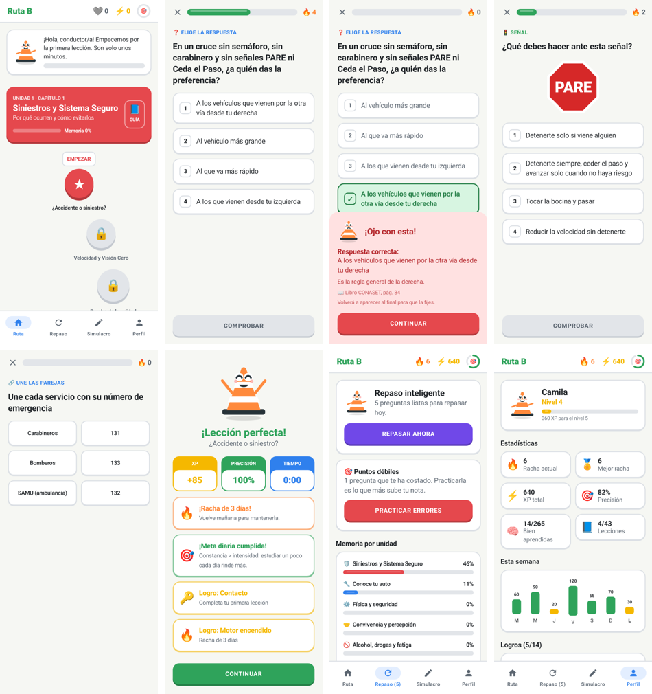

# Ruta B: estudia para tu licencia de conducir Clase B 🚦

App Android nativa (Kotlin + Jetpack Compose) para preparar el **examen teórico de la licencia Clase B en Chile**, gamificada al estilo de las apps de idiomas. El contenido sale del *Libro para la Conducción en Chile – Clase B* (CONASET, febrero 2026), que también está en este repositorio.



## Instalar

1. Descarga [`release/RutaB-2.1.apk`](release/RutaB-2.1.apk) en tu teléfono Android (8.0 o superior).
2. Ábrelo y permite "Instalar apps desconocidas" si te lo pide.

> El APK está firmado con una clave de depuración para poder instalarlo directamente. Para publicarlo en Google Play hay que firmarlo con una clave propia.

## Qué incluye

- **265 preguntas** repartidas en **11 unidades y 31 lecciones**, cada una con su explicación y la página del libro.
- **5 formatos de pregunta**: opción múltiple, verdadero/falso, señales dibujadas (PARE, Ceda el Paso, semáforos, Cruz de San Andrés…), unir parejas y ordenar pasos.
- **Ruta de aprendizaje** con lecciones que se desbloquean en orden y una prueba al final de cada unidad.
- **Guía por unidad** con las ideas clave.
- **Repaso inteligente** con repetición espaciada, y una sección de **puntos débiles**.
- **Simulacro de examen**: 35 preguntas de todas las unidades, 3 con doble puntaje, aprueba con 33 de 38 puntos.
- **Gamificación**: XP, niveles, racha diaria, meta diaria, 14 logros, gráfico semanal y la mascota *Cono*.
- **Recordatorio diario** opcional, que solo avisa si aún no cumpliste tu meta.
- Modo claro y oscuro. Funciona sin conexión.

## Métodos de estudio aplicados (investigación)

| Técnica | Qué dice la evidencia | Cómo se aplica en la app |
|---|---|---|
| **Práctica de recuperación** (*testing effect*) | Es la técnica con más respaldo. Responder preguntas fija mejor que releer (meta-análisis en aula: g ≈ 0,50). | Cada lección es un mini examen. No hay "leer y pasar". |
| **Repetición espaciada** | Repasar en intervalos crecientes es clave para la retención a largo plazo, sobre todo después de un mes o más. | Cajas de Leitner: las preguntas vuelven a los 1, 3, 7, 14 y 30 días. Si fallas, vuelve hoy. |
| **Práctica intercalada** | Mezclar temas mejora el resultado tras un tiempo, aunque al principio se sienta más difícil. Su evidencia es más variable. | Las pruebas de unidad, los repasos y los simulacros mezclan temas, como el examen real. |
| **Retroalimentación inmediata y elaborada** | Corregir el error en el momento evita fijar respuestas equivocadas. | Cada respuesta muestra la correcta, una explicación y la página del libro. Lo fallado vuelve al final de la lección. |
| **Hábito y constancia** | Rachas, XP y metas aumentan la constancia en apps como Duolingo. | Racha, meta diaria, niveles, logros y recordatorio. |
| **Evitar los efectos negativos de la gamificación** | Algunos estudios muestran que las ligas y la competencia distraen, y que el XP puede premiar cantidad sobre calidad. | No hay ligas ni vidas que castiguen errar. Se gana más XP acertando a la primera, y la meta final es aprobar simulacros. |

## Desarrollo

```bash
./gradlew assembleRelease              # APK en app/build/outputs/apk/release/
./gradlew testDebugUnitTest            # pruebas de lógica + capturas (Paparazzi)
./gradlew recordPaparazziDebug         # regenerar capturas en app/src/test/snapshots/
```

- `app/src/main/assets/content.json`: unidades, guías y preguntas. En las preguntas de opción múltiple, **la primera opción es la correcta**: la app las baraja al mostrarlas.
- `data/Srs.kt`: repetición espaciada. `Session.kt`: flujo de lecciones y simulacros. `AppViewModel.kt`: progreso, racha, XP y logros.

App de estudio independiente, sin afiliación con CONASET. Revisa siempre la normativa vigente.
